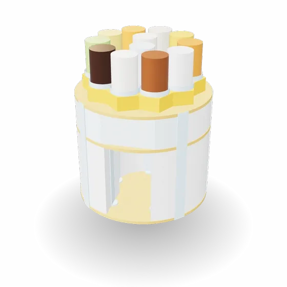
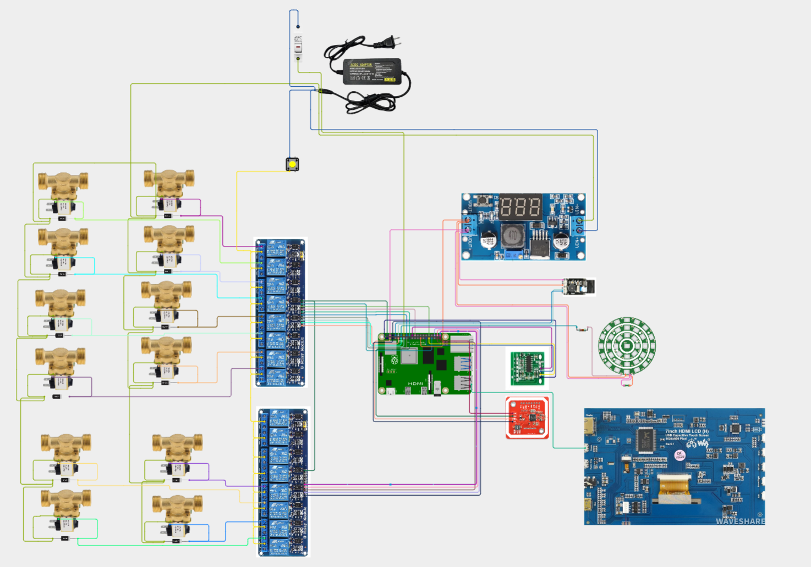
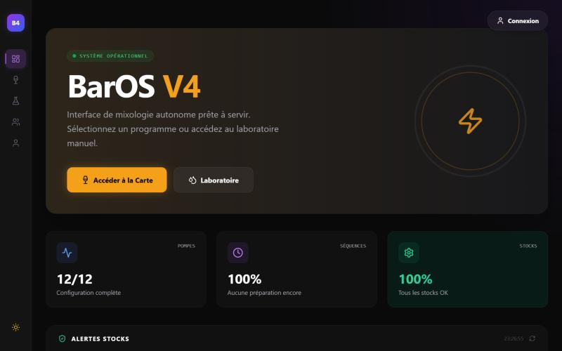
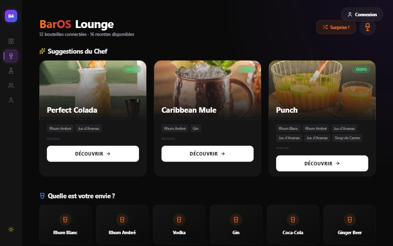
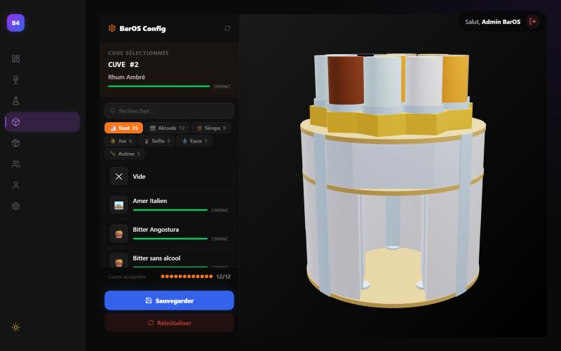
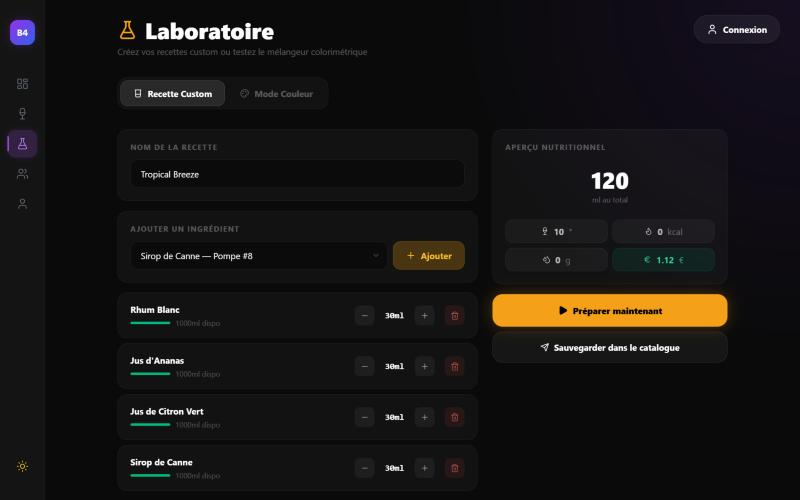
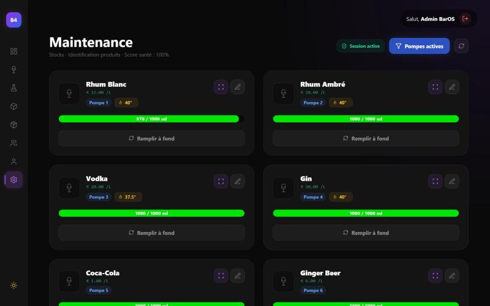
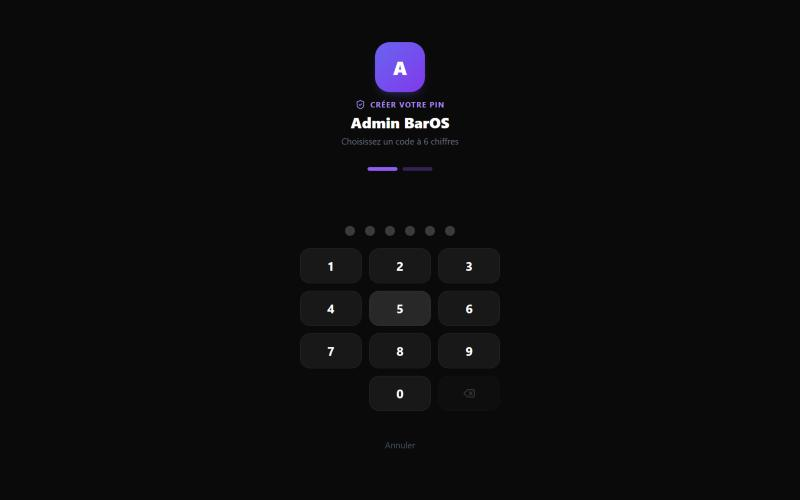

<div align="center">

# BarOS V4

**Système de bar automatisé piloté par Raspberry Pi**  
*Physique des fluides · Interface 3D temps réel · Paiement Stripe · PWA mobile*

[](https://python.org)
[](https://fastapi.tiangolo.com)
[](https://react.dev)
[](https://docker.com)
[](tests/)
[](LICENSE)

---

*Projet de spécialité IA · ESME Paris · Mattéo Bombrun*

</div>

<p align="center">
  
  <br />
  <sub>Modèle 3D de la machine · design de <b>Corentin Haverlant</b></sub>
</p>

> 🛠️ **Statut :** logiciel complet et testé en mode simulation. L'assemblage de la machine physique est en cours ; les photos arriveront ici.

---

## 📖 Vue d'ensemble

BarOS est un système embarqué complet qui automatise la préparation de cocktails via une machine à électrovannes pilotée par Raspberry Pi. Un utilisateur scanne son badge NFC sur la borne, choisit son cocktail sur l'interface web, paie par carte ou solde prépayé — la machine calcule les durées de versement par la physique et dose chaque ingrédient avec précision.

> Ce projet couvre l'intégralité de la stack : physique embarquée, backend distribué, interface React 3D, paiement Stripe, file d'attente temps réel et déploiement Docker.

---

## ✨ Fonctionnalités

| Domaine | Fonctionnalité |
|---|---|
| 🍹 **Machine** | Dosage 12 cuves par électrovannes, séquencement GPIO, arrêt d'urgence |
| 🧪 **Physique** | Loi de Torricelli analytique, calcul exact de la durée de versement |
| 💳 **Paiement** | Stripe Checkout, solde prépayé NFC, remboursement automatique en cas d'erreur hardware |
| 📱 **PWA** | Notifications push WebPush, file d'attente temps réel (WebSocket) |
| 🎨 **UI** | Interface React avec modèle 3D interactif, SmartBar avec suggestions IA |
| 🔒 **Admin** | Dashboard analytique, gestion stocks, export Excel, authentification PIN |
| 🐳 **Infra** | Docker Compose (FastAPI + Nginx + React), SQLite avec volume persistant |

---

## 🏗️ Architecture système

```
┌─────────────────────────────────────────────────────────────────┐
│                        CLIENT (Browser / PWA)                   │
│              React 18 · Vite · Three.js · Tailwind              │
└────────────────────────────┬────────────────────────────────────┘
                             │ HTTP / WebSocket
                             ▼
┌─────────────────────────────────────────────────────────────────┐
│                      NGINX (Reverse Proxy)                      │
│         /* → static build      /api/* → FastAPI :8000           │
└──────────────┬──────────────────────────┬───────────────────────┘
               │                          │
               ▼                          ▼
┌──────────────────────┐    ┌─────────────────────────────────────┐
│   Static Files       │    │         FastAPI Backend              │
│   (React build)      │    │                                     │
└──────────────────────┘    │  ┌─────────────┐  ┌─────────────┐  │
                            │  │   Routers   │  │  Services   │  │
                            │  │  cocktails  │  │ CocktailSvc │  │
                            │  │  payments   │  │ FluidPhysics│  │
                            │  │  queue      │  │ GPIO Mgr    │  │
                            │  │  users      │  └─────────────┘  │
                            │  └──────┬──────┘                   │
                            │         │ SQLAlchemy 2.0            │
                            │         ▼                           │
                            │  ┌─────────────┐                   │
                            │  │   SQLite    │ ← volume Docker   │
                            │  │  baros.db   │                   │
                            │  └─────────────┘                   │
                            └──────────────┬──────────────────────┘
                                           │ asyncio · GPIO
                                           ▼
                            ┌─────────────────────────────────────┐
                            │        Raspberry Pi (Hardware)       │
                            │   12 électrovannes · relais · NFC   │
                            │   GPIO 40 pins · Emergency Stop     │
                            └─────────────────────────────────────┘
```

### Stack technique

| Couche | Technologie | Rôle |
|---|---|---|
| Frontend | React 18, Vite, Three.js, Tailwind CSS | Interface utilisateur, visualisation 3D |
| Backend | FastAPI, SQLAlchemy 2.0, Pydantic | API REST + WebSocket |
| Hardware | RPi.GPIO, asyncio | Pilotage des électrovannes, NFC |
| Paiement | Stripe Checkout + Webhooks | Transactions sécurisées |
| Infra | Docker Compose, Nginx | Déploiement, reverse proxy |
| Tests | Pytest | 35 tests unitaires physique |

---

## ⚡ Électronique

Les ingrédients s'écoulent par gravité depuis 12 cuves. Chaque cuve est fermée par une électrovanne 12 V, ouverte pendant la durée calculée par la loi de Torricelli.



> ⚠️ **Schéma de conception (v0).** Il sera révisé après l'assemblage et les essais de la première version : position du fusible, arrêt d'urgence à verrouillage (NC), alimentation des relais et dimensionnement du 5 V.

| Composant | Rôle | Liaison |
|---|---|---|
| Raspberry Pi 4B | Contrôleur et serveur backend | — |
| 12 électrovannes 12 V | Ouvrent chaque cuve pendant la durée calculée | via relais |
| 2 modules 8 relais | Commutent les électrovannes (12 relais utilisés) | GPIO |
| 12 diodes 1N4007 | Protègent contre les surtensions à la coupure des bobines (roue libre) | — |
| Alimentation 12 V, fusible, arrêt d'urgence | Alimentation des électrovannes ; l'arrêt coupe le 12 V des relais sans éteindre la Pi | — |
| Convertisseur LM2596 | Abaisse le 12 V en 5 V pour les périphériques | — |
| Lecteur NFC/RFID PN532 | Identification par badge | I²C (GPIO 2/3) |
| Lecteur de codes-barres GM65 | Scan des bouteilles pour renseigner les ingrédients | UART (GPIO 14/15) |
| Cellule de pesée + HX711 | Mesure du poids | GPIO 5/6 |
| Anneau de LED WS2812B | Retour visuel pendant la préparation | GPIO 18 |
| Écran tactile Waveshare 7" | Borne de commande | HDMI + USB |

<details>
<summary>Correspondance électrovanne → relais → GPIO</summary>

| Électrovanne | Relais | GPIO |
|---|---|---|
| 1 | Module 2 · K1 | 17 |
| 2 | Module 2 · K2 | 27 |
| 3 | Module 2 · K3 | 22 |
| 4 | Module 2 · K4 | 23 |
| 5 | Module 2 · K5 | 24 |
| 6 | Module 2 · K6 | 25 |
| 7 | Module 1 · K1 | 16 |
| 8 | Module 1 · K2 | 26 |
| 9 | Module 1 · K4 | 21 |
| 10 | Module 1 · K3 | 20 |
| 11 | Module 2 · K7 | 12 |
| 12 | Module 2 · K8 | 13 |

</details>

---

## 🧪 Physique des fluides — Loi de Torricelli

Le dosage précis est le cœur technique du projet. La durée de versement est calculée par la **loi de Torricelli**, qui modélise le débit d'un fluide s'écoulant sous l'effet de la gravité.

### Modèle physique

Le débit instantané dépend du niveau de remplissage de la cuve :

$$Q(v) = Q_{max} \cdot \sqrt{\frac{v}{V_{max}}}$$

Avec $Q_{max} = 10\ \text{ml/s}$ (débit calibré sur les électrovannes).

### Résolution analytique

L'approche naïve (intégration numérique pas à pas, $dt = 10ms$) est coûteuse et imprécise. On résout l'équation différentielle exactement :

$$\frac{dv}{dt} = -Q_{max} \cdot \sqrt{\frac{v}{V_{max}}}$$

Par séparation des variables et intégration de $v_{start}$ à $v_{end} = v_{start} - V_{target}$ :

$$\boxed{T = \frac{2\sqrt{V_{max}}}{Q_{max}} \cdot \left(\sqrt{v_{start}} - \sqrt{v_{end}}\right)}$$

### Gain de performance

| Méthode | Temps de calcul | Précision |
|---|---|---|
| Intégration numérique ($dt = 10ms$) | ~0.18 ms/appel | ±10 ms |
| **Formule analytique** | **~0.0002 ms/appel** | **<1 ms** |
| Gain | **×730 plus rapide** | **×10 plus précis** |

### Validation (Pytest)

```
35 tests · 6 catégories · 0.12s · 100% passed

TestPhysicalCoherence      ·····  Cohérence physique (monotonie, débit)
TestAnalyticalFormula      ·······  Vérification numérique indépendante
TestEdgeCases              ·····  Cas limites (quasi-vide, vidage total)
TestInstantaneousFlowRate  ······  Débit instantané
TestInputValidation        ········  Validation des entrées (ValueError)
TestPerformance            ··  < 1ms/appel garanti
```

---

## 🖥️ Interface

*Captures réalisées en mode simulation (sans Raspberry Pi), avec les données de démonstration du projet.*

### Tableau de bord
État des 12 électrovannes (appelées « pompes » dans l'interface), taux de succès des préparations et alertes de stock en temps réel.



### SmartBar
Interface principale de commande, avec des suggestions basées sur les favoris, les notes et la disponibilité des ingrédients en temps réel. Seuls les cocktails réalisables avec les bouteilles connectées sont proposés.



### Configuration 3D
Modèle 3D interactif de la machine (Three.js) pour assigner visuellement les ingrédients aux 12 cuves. Un clic sur un cylindre le sélectionne ; au survol d'un ingrédient dans la liste, la cuve correspondante s'illumine.



### Laboratoire et maintenance

| Laboratoire : recettes sur mesure | Maintenance : niveaux et prix par cuve |
|---|---|
|  |  |

Le laboratoire calcule en direct le volume, le degré d'alcool et le prix de vente d'une recette. La page de maintenance suit le niveau de chaque cuve : on y voit les 30 ml de rhum consommés par la préparation de test.

### Identification
Chaque utilisateur s'identifie avec son badge NFC, puis un code PIN à 6 chiffres.



---

## 🚀 Lancement rapide (Docker)

### Prérequis
- Docker Desktop installé
- Un compte Stripe (clés test suffisantes)

### Installation

```bash
# 1. Clone
git clone https://github.com/Monday69/BarOS_V4.git
cd BarOS_V4

# 2. Configuration
cp .env.example .env
# Édite .env : renseigne au minimum BAROS_ADMIN_SECRET (et les clés Stripe pour le paiement)

# 3. Lancement
docker-compose up --build
```

L'application est disponible sur **http://localhost**

| Service | URL |
|---|---|
| Application | http://localhost |
| API docs (Swagger) | http://localhost/api/docs |
| Backend direct | http://localhost:8000 |

### Arrêt

```bash
docker-compose down          # Arrêt (données conservées)
docker-compose down -v       # Arrêt + suppression des volumes
```

---

## 💻 Lancement en développement (sans Docker)

Sans Raspberry Pi, le backend passe automatiquement en **mode simulation** : les électrovannes sont simulées et toute l'interface reste utilisable.

```bash
# Backend (depuis la racine)
python -m venv venv
venv\Scripts\activate            # Linux/macOS : source venv/bin/activate
pip install -r requirements.txt
cp .env.example .env              # puis renseigner BAROS_ADMIN_SECRET
uvicorn backend.main:app --port 8000 --env-file .env

# Données de démonstration (dans un second terminal, backend lancé)
python -m tools.seed_data
python -m backend.scripts.import_cocktails --real

# Frontend
cd frontend
npm install
npm run dev                       # http://localhost:5173 (proxy /api vers le backend)
```

---

## 🧪 Tests

```bash
# Depuis la racine du projet
pip install pytest
pytest tests/ -v

# Avec détail des performances
pytest tests/test_fluid_physics.py -v -s
```

```
============= 35 passed in 0.12s =============
```

---

## 📁 Structure du projet

```
BarOS_V4/
├── backend/
│   ├── main.py              # Point d'entrée FastAPI
│   ├── models.py            # Modèles SQLAlchemy 2.0
│   ├── database.py          # Configuration DB (SQLite / PostgreSQL)
│   ├── routers/             # cocktails, payments, queue, users, machine...
│   ├── services/
│   │   └── cocktail_service.py   # Logique séquencement + remboursement
│   ├── logic/
│   │   └── fluid_physics.py      # Loi de Torricelli analytique
│   └── hardware/
│       └── gpio_manager.py       # Pilotage GPIO Raspberry Pi
├── frontend/
│   ├── src/
│   │   ├── api.js           # Configuration API centralisée
│   │   ├── pages/           # SmartBar, Dashboard, TestMachine, ProfilePage...
│   │   ├── components/      # Layout, LoginModal, 3D/Machine...
│   │   └── context/         # UserContext, ThemeContext
│   └── public/
│       └── models/          # Modèle GLTF machine 3D
├── tests/
│   └── test_fluid_physics.py    # 35 tests unitaires Pytest
├── config/
│   └── config.json          # Configuration machine (électrovannes, cuves)
├── docker-compose.yml
├── Dockerfile.backend
├── Dockerfile.frontend
├── nginx.conf
└── requirements.txt
```

---

## 🔄 Flux de commande

```
User scanne badge NFC
        │
        ▼
Authentification → Solde vérifié
        │
        ▼
Choix cocktail (SmartBar)
        │
        ▼
Paiement (Stripe ou solde)
        │
        ▼
Création PourSequence en DB
        │
        ├─ Réservation stock atomique (Phase 1)
        │
        ├─ Calcul durées Torricelli par ingrédient
        │
        ├─ Séquencement GPIO électrovannes (Phase 2)
        │         │
        │         ├─ Erreur hardware → Emergency Stop
        │         │                 → Remboursement stock + solde automatique
        │         │                 → Flag OrderHistory.refunded = True (idempotent)
        │         │
        │         └─ Succès → Toutes les steps COMPLETED
        │
        └─ PourSequence status = COMPLETED
```

---

## 🔒 Sécurité & robustesse

- **Mutex machine** (`asyncio.Lock`) — une seule séquence de versement à la fois
- **Remboursement idempotent** — `OrderHistory.refunded` flag atomique, impossible de rembourser deux fois
- **Emergency stop** — coupe toutes les électrovannes ouvertes en cas d'exception hardware
- **Validation Pydantic** — chaque entrée API est strictement typée et validée
- **Rate limiting** — protection des endpoints sensibles
- **Admin guard** — routes admin protégées par authentification PIN

---

## 🙏 Crédits

- **Corentin Haverlant** : conception du modèle 3D de la machine.

---

## 📄 Licence

MIT — Mattéo Bombrun · ESME Paris

---

<div align="center">

*Construit avec FastAPI, React, Three.js et beaucoup de physique.*

</div>